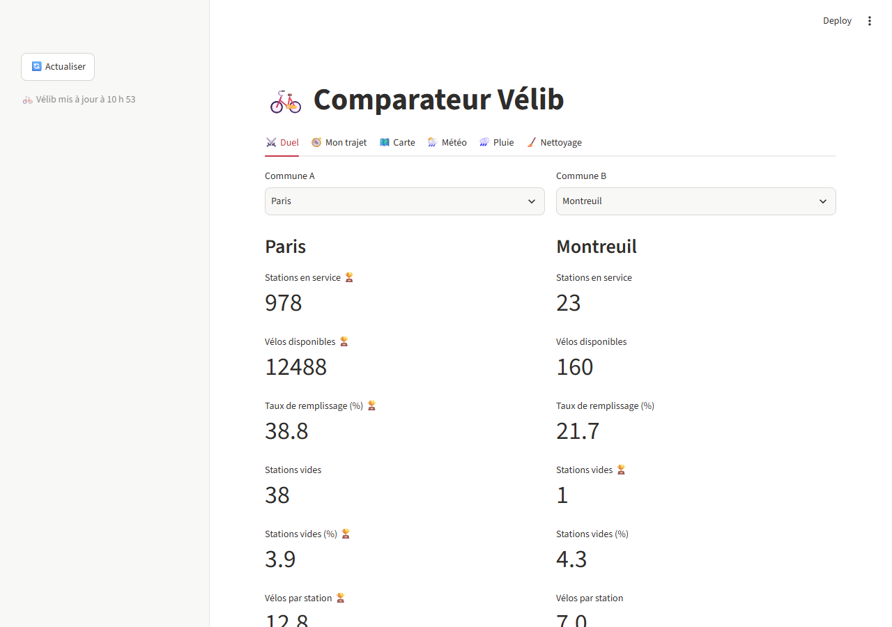
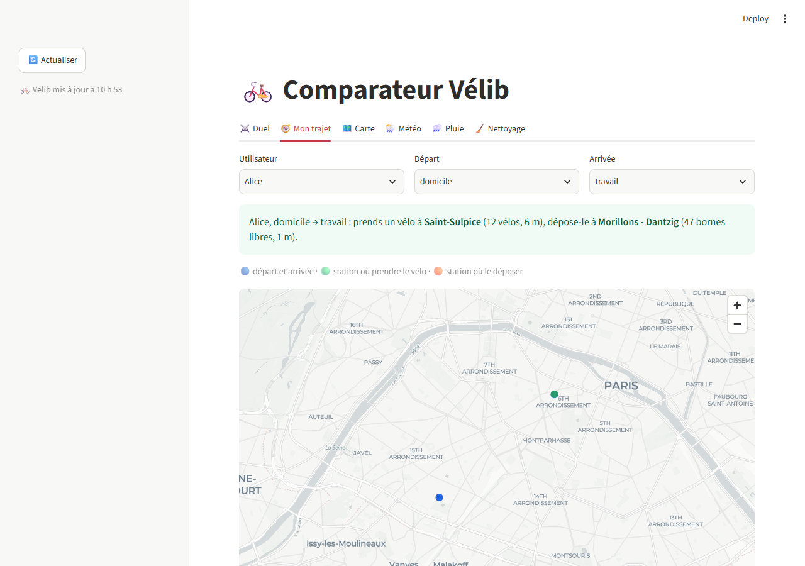
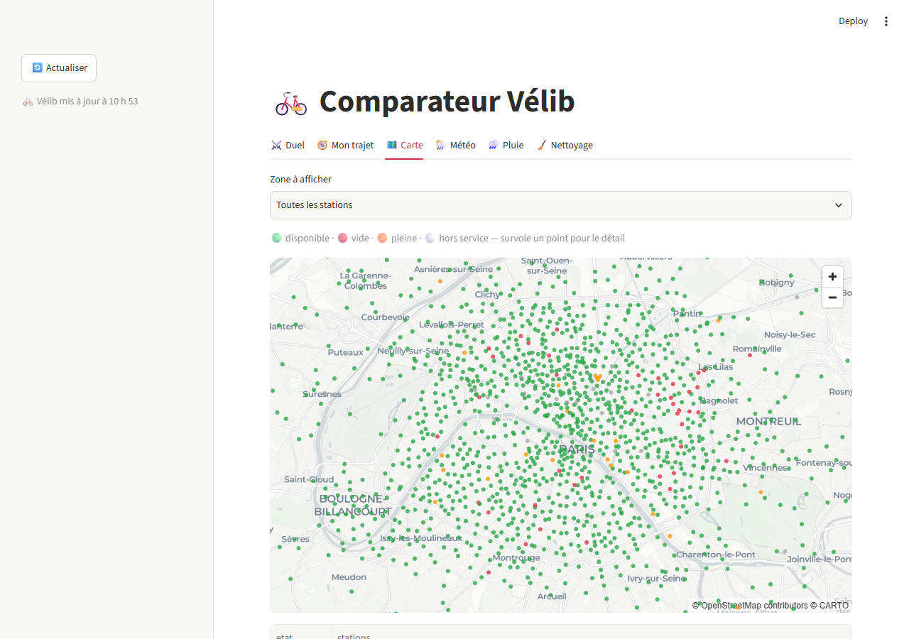
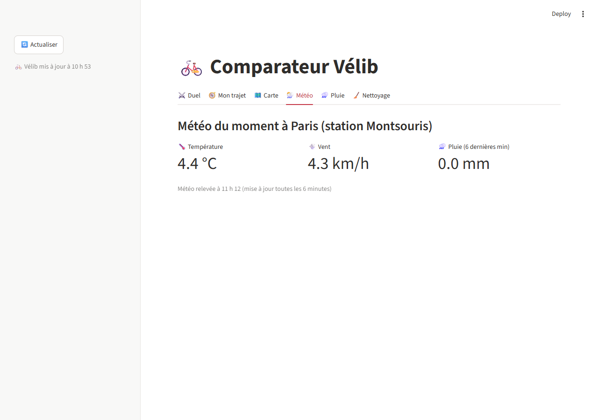
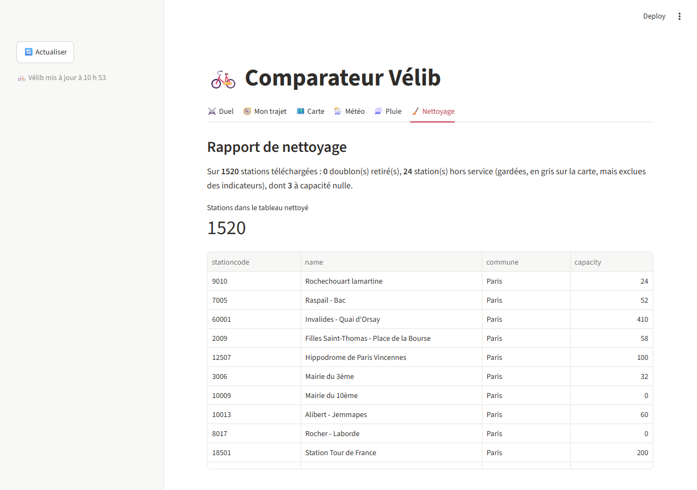

# Comparateur Vélib

Compare la disponibilité des Vélib entre deux communes (ou arrondissements de Paris), en ligne de commande ou dans une application web, avec la météo du moment.



## Installation

```bash
python -m venv .venv
.venv\Scripts\activate          # Windows (sur macOS / Linux : source .venv/bin/activate)
pip install -r requirements.txt
```

Le rôle de chaque bibliothèque est expliqué dans [`bibliotheque_def.md`](bibliotheque_def.md).

## Clé API Météo-France

L'application affiche la météo du moment grâce à l'API Météo-France. Chacun crée **sa propre clé**, qui ne doit jamais être envoyée sur GitHub.

1. Créer un compte sur https://portail-api.meteofrance.fr et confirmer l'e-mail.
2. Dans le catalogue des API, choisir **Données Publiques d'Observation** et s'y abonner (gratuit).
3. Dans « Mes API », générer une clé de type **API Key** (choisir sa durée de validité) et la copier.
4. Créer le fichier `.env` à partir du modèle, puis y coller la clé :
   ```powershell
   Copy-Item .env.example .env
   ```
   ```
   METEO_FRANCE_API_KEY=ta_cle_ici
   ```
5. Vérifier que `git status` n'affiche pas `.env` : il est ignoré par `.gitignore`.

Quand la clé expire, il suffit d'en générer une nouvelle et de remplacer la valeur dans `.env`.
Sans clé, tout fonctionne sauf l'onglet Météo, qui affiche un message.

## Utilisation

### En ligne de commande

```bash
python compare.py Paris Montreuil
python compare.py "Paris 11" Montreuil      # arrondissements : "Paris 1" à "Paris 20"
```

```
             🚲 Vélib : Paris 11 contre Montreuil
┌─────────────────────────┬──────────┬───────────┬───────────┐
│ Indicateur              │ Paris 11 │ Montreuil │ Gagnant   │
├─────────────────────────┼──────────┼───────────┼───────────┤
│ Stations en service     │       56 │        23 │ Paris 11  │
│ Vélos disponibles       │      663 │       165 │ Paris 11  │
│ Taux de remplissage (%) │     30.7 │      22.4 │ Paris 11  │
│ Stations vides          │        4 │         1 │ Montreuil │
│ Stations vides (%)      │      7.1 │       4.3 │ Montreuil │
│ Vélos par station       │     11.8 │       7.2 │ Paris 11  │
│ Part d'électriques (%)  │     22.3 │      88.5 │ Montreuil │
└─────────────────────────┴──────────┴───────────┴───────────┘
Résultat : Paris 11 gagne
```

Les noms acceptent n'importe quelle casse, avec ou sans accents. En cas de faute de frappe :

```
python compare.py Paris montreuill
Erreur : Commune introuvable : « montreuill ». Vouliez-vous dire Montreuil ?
```

Sans connexion internet, les résultats viennent du dernier téléchargement (`data/brut/velib.csv`), avec un avertissement.

### Application web

```bash
streamlit run app.py
```

| Onglet | Contenu |
|---|---|
| ⚔️ Duel | Deux communes ou arrondissements côte à côte, 🏆 sur chaque indicateur gagnant, gagnant global |
| 🧭 Mon trajet | Pour un utilisateur (inventé) et un trajet, la station où prendre un vélo et celle où le déposer |
| 🗺️ Carte | Toutes les stations : 🟢 disponible, 🔴 vide, 🟠 pleine, ⚪ hors service ; détail au survol |
| 🌦️ Météo | Température, vent et pluie à Paris-Montsouris |
| 🌧️ Pluie | Effet de la pluie sur le remplissage, d'après l'historique collecté |
| 🧹 Nettoyage | Rapport de nettoyage : stations téléchargées, doublons, hors service, capacités nulles |

Le bouton **🔄 Actualiser** retélécharge les données. Sinon, les données Vélib sont gardées 1 minute et la météo 10 minutes.
L'heure affichée (« Vélib mis à jour à… ») est celle du relevé des stations : l'open data de Paris a souvent une vingtaine de minutes de retard.

| Mon trajet | Carte |
|---|---|
|  |  |
| **Météo** | **Nettoyage** |
|  |  |

### Collecte de l'historique (bonus)

```bash
python collecter.py              # un relevé toutes les 15 minutes, Ctrl+C pour arrêter
python collecter.py --une-fois   # un seul relevé
```

Les relevés s'ajoutent dans `data/historique/releves.csv` (ignoré par git) et alimentent l'onglet 🌧️ Pluie.

### Autres commandes

```bash
python -m pytest              # lance les tests
python -m src.recuperation    # télécharge les données Vélib dans data/brut/velib.csv
python explorer_velib.py      # affiche les constats sur les données brutes (data/constats_velib.md)
```

## Règles de calcul

- Les stations **hors service** restent dans les données (en gris sur la carte) mais ne comptent dans **aucun indicateur**.
- Taux de remplissage = vélos / (vélos + bornes libres) : seules les bornes qui fonctionnent comptent.
- « Plus » est meilleur pour tous les indicateurs, sauf les stations vides (nombre et %).
- Arrondissement d'une station parisienne : les premiers chiffres de son code (`11024` → Paris 11).

Le détail des décisions et l'avancement des issues sont dans [`RELAIS.md`](RELAIS.md).

## Organisation du code

| Fichier | Rôle |
|---|---|
| `src/recuperation.py` | Téléchargement Vélib (avec repli sur le dernier CSV), utilisateurs |
| `src/nettoyage.py` | `nettoyer_velib()`, `normaliser()`, zones, suggestion en cas de faute de frappe |
| `src/indicateurs.py` | `stats_commune()`, état des stations |
| `src/comparaison.py` | `comparer()`, `bilan()` |
| `src/meteo.py` | `meteo_actuelle()` (API Météo-France v2) |
| `src/trajet.py` | `distance_m()`, `station_conseillee()` |
| `src/collecte.py`, `src/analyse_pluie.py` | Historique et effet de la pluie |
| `compare.py`, `app.py`, `collecter.py` | Points d'entrée : ils n'appellent que les fonctions de `src/` |
| `tests/` | Tests `pytest`, sur des stations réelles figées (`tests/donnees_test.csv`) |
