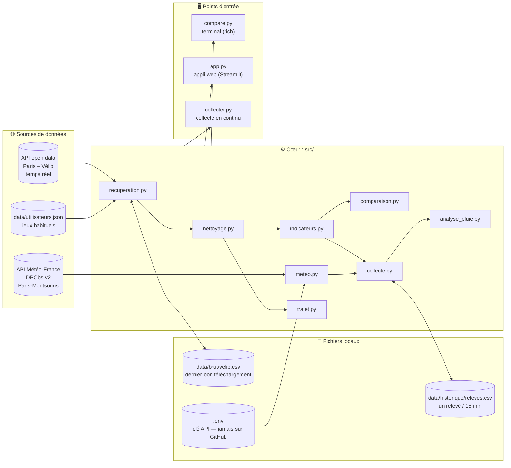
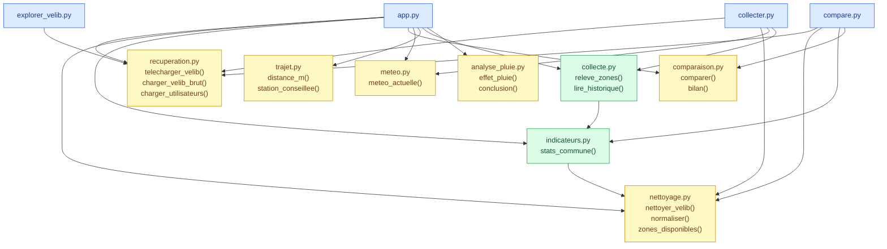
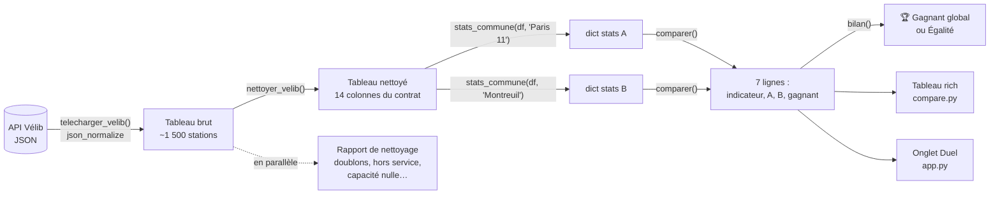
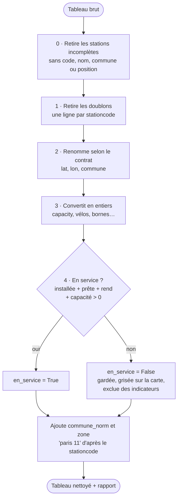
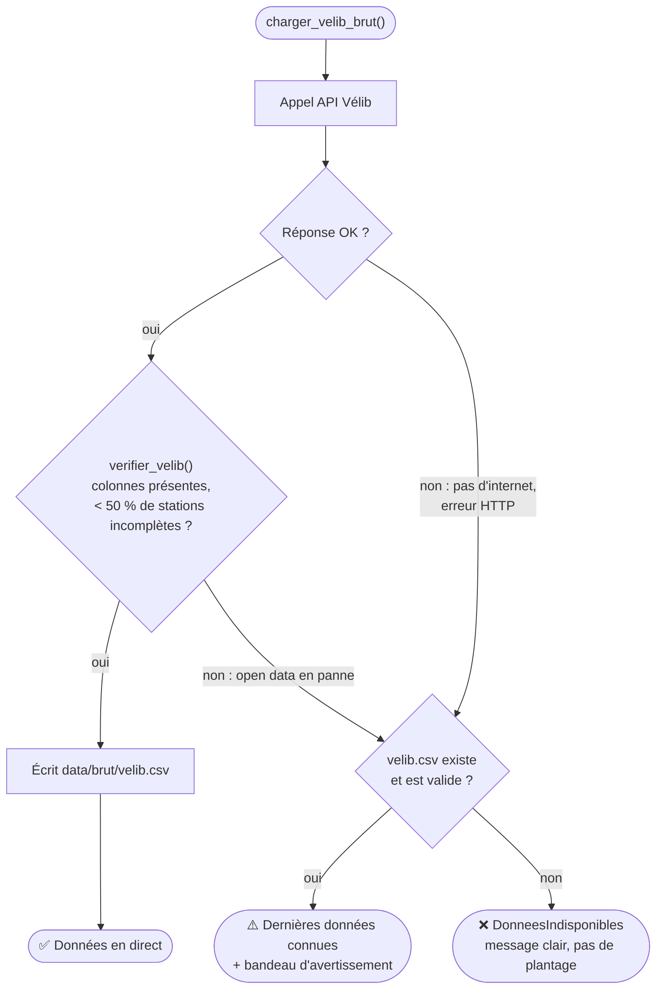
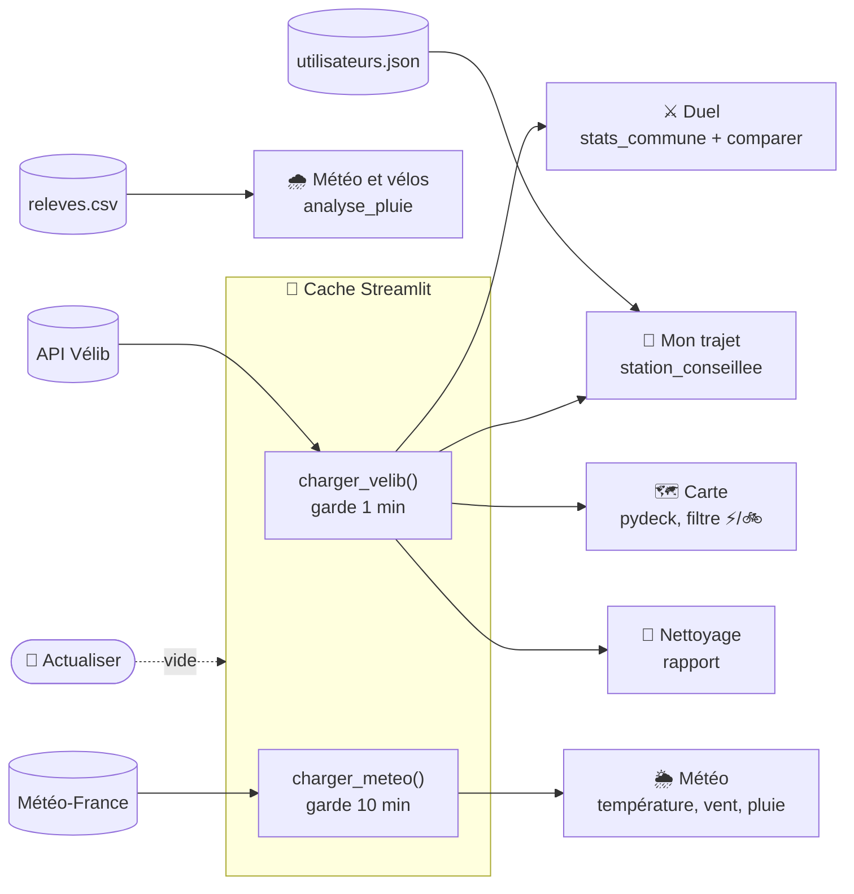
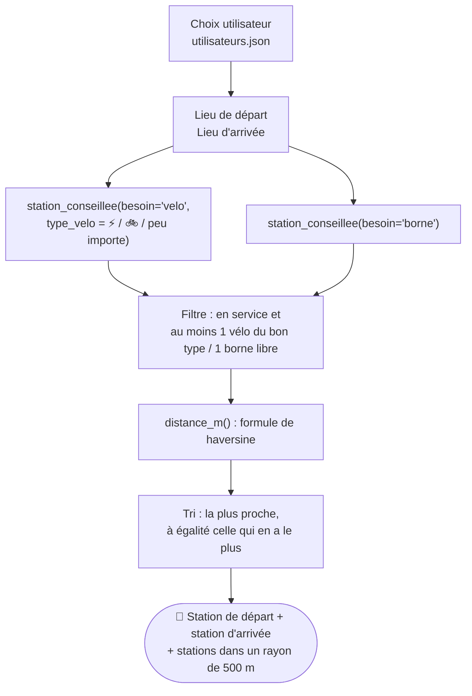
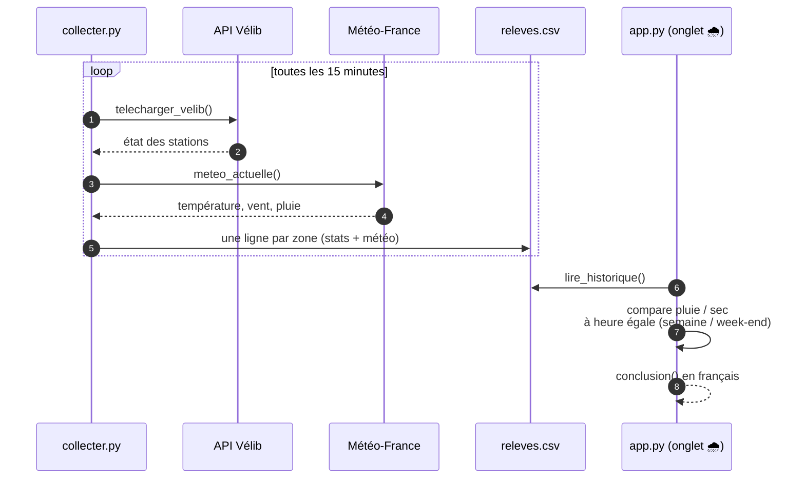
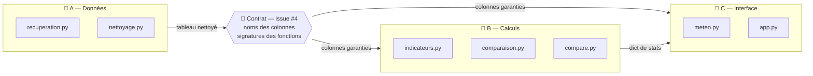

# 🚲 Comparateur Vélib — Présentation

> Comparer en direct la disponibilité des Vélib entre deux communes (ou arrondissements de Paris),
> en ligne de commande ou dans une application web, avec la météo du moment.

**Équipe** : A (données) · B (calculs) · C (interface)
**Dépôt** : `95902/velib-comparator` · 49 PR fusionnées · 78 tests qui passent

> 💡 Les schémas sont écrits en **Mermaid** : du texte simple, modifiable dans Sublime Text.
> Ils s'affichent en graphiques sur GitHub, dans VS Code (extension *Markdown Preview Mermaid*),
> ou en collant un bloc sur https://mermaid.live pour l'exporter en PNG/SVG pour les diapos.

---

## 1. Le problème

Le matin, on veut savoir **où trouver un vélo** et **où le déposer**.
Paris publie l'état de ses ~1 500 stations Vélib en temps réel, mais sous forme de données brutes :
noms de communes incohérents, doublons, stations hors service, capacités à zéro…

**Notre objectif** :
1. récupérer ces données de façon fiable, même si l'API tombe ;
2. les nettoyer selon un **contrat** commun à toute l'équipe ;
3. calculer des indicateurs comparables entre deux zones ;
4. les présenter simplement : un terminal, une appli web, une carte, la météo.

---

## 2. Vue d'ensemble : sources, cœur, sorties

Trois **sources de données** entrent, un **cœur de calcul** commun les transforme,
trois **points d'entrée** les exploitent.



---

## 3. Dépendances entre modules (qui importe qui)

Chaque flèche = un `import`. Le graphe **n'a pas de boucle** : on peut tester chaque module seul.
`nettoyage.py` est la fondation ; les trois scripts à la racine ne font qu'assembler les briques.



🟦 points d'entrée · 🟩 modules qui en utilisent d'autres · 🟨 modules indépendants

---

## 4. Le parcours d'une donnée : de l'API à l'écran

Le même chemin sert au terminal et à l'appli web. Entre chaque étape, la forme de la donnée
est fixée par le **contrat** (issue #4).



**Les étapes du nettoyage** (`nettoyer_velib`) :



---

## 5. Les indicateurs comparés

| Indicateur | Calcul | Gagnant |
|---|---|---|
| Stations en service | nombre de stations `en_service` | plus grand |
| Vélos disponibles | somme des vélos | plus grand |
| Taux de remplissage | vélos / (vélos + bornes libres) | plus grand |
| Stations vides | stations sans vélo | **plus petit** |
| Stations vides (%) | vides / stations en service | **plus petit** |
| Vélos par station | vélos / stations | plus grand |
| Part d'électriques | électriques / vélos | plus grand |

**Décision d'équipe** : on divise par `vélos + bornes libres` plutôt que par `capacity`, car
15 stations ont plus de vélos que de bornes (BNF : 64 vélos pour 42 bornes). Sinon on dépasserait 100 %.

---

## 6. Robustesse : que se passe-t-il si l'API tombe ?

On garde toujours le **dernier bon téléchargement** comme secours, et une réponse vide
ne l'écrase jamais (PR #48).



Autres erreurs gérées : commune mal tapée (`montreuill` → « Vouliez-vous dire Montreuil ? »),
clé Météo-France absente (tout marche sauf l'onglet Météo).

---

## 7. L'application web : onglets et cache

Streamlit garde les données en mémoire pour ne pas rappeler les API à chaque clic.
Le bouton **🔄 Actualiser** vide ce cache.



---

## 8. Bonus : « Mon trajet »

Pour un utilisateur et un trajet (ex. domicile → travail), on conseille **où prendre**
et **où déposer** un vélo.



---

## 9. Bonus : la pluie fait-elle fuir les cyclistes ?

L'API ne donne pas les trajets, seulement l'état des stations. Nous mesurons donc l'effet **indirectement** :
moins de cyclistes = stations **plus pleines** ; électriques préférés sous la pluie = **moins d'électriques** en station.



**Piège évité** : la pluie et les heures de pointe se mélangent. On compare donc les relevés
**au même créneau horaire**. Collecte lancée le 8 novembre 2026 ; conclusion après quelques jours de pluie.

---

## 10. Organisation de l'équipe



- **Le contrat d'abord** : tout le monde a pu coder en parallèle dès le jour 1, sur de fausses données (`tests/donnees_test.csv`).
- **Une branche et une PR par tâche** : `main` marche toujours.
- **`RELAIS.md`** : le journal des décisions et de l'avancement.
- **78 tests `pytest`** : nettoyage, indicateurs, comparaison, météo, trajet, erreurs, collecte.

---

## 11. Démonstration

```bash
python compare.py "Paris 11" Montreuil     # duel dans le terminal
python compare.py montreuill Paris         # faute de frappe → suggestion
streamlit run app.py                       # appli web : duel, trajet, carte, météo
python collecter.py --une-fois             # un relevé dans l'historique
pytest                                     # 78 tests
```

---

## 12. Bilan et pistes

**Ce qu'on a appris**
- Les données réelles sont sales : nettoyer prend autant de temps que calculer.
- Un contrat écrit évite les conflits entre membres de l'équipe.
- Prévoir la panne (API, clé absente, faute de frappe) fait la différence en démonstration.

**Pistes**
- Conclure l'analyse météo après plusieurs semaines de collecte.
- Prédire le remplissage d'une station à une heure donnée.
- Station de secours dans « Mon trajet » si la première se vide en chemin.

**Merci ! Questions ?**
